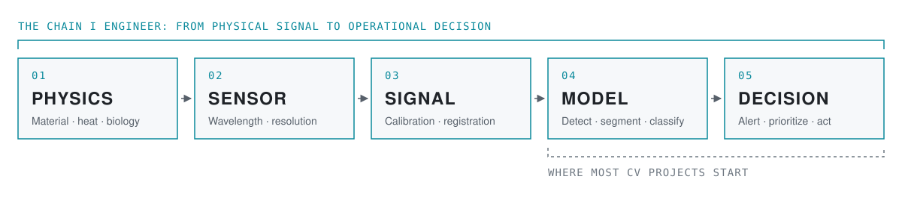
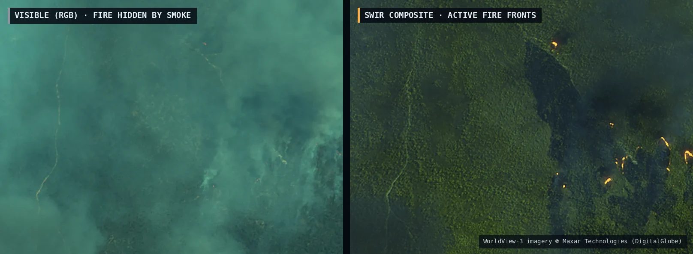

# Bernard Lawes

**Vision and geospatial AI engineer · Solutions Architect · Miami (open to remote)**

Most computer vision projects start with an available RGB image and a pretrained model. I work farther upstream. I determine what must be observed, how it should be measured, and whether the resulting signal can support a reliable operational decision. Then I build the system that carries it from sensor to deployed application.

Over 10+ years I've delivered imagery and vision systems for defense, maritime, agriculture, and environmental clients across 23 countries. I currently run [Spatial Mapping](https://bernardlawes.com), an independent vision engineering practice.

<picture>
  <source media="(prefers-color-scheme: dark)" srcset="assets/pipeline-dark.svg">
  
</picture>

---

### Selected work

Same scene, two measurements. In visible light the fire is hidden by smoke; shortwave infrared passes through it. WorldView-3 imagery © Maxar Technologies (DigitalGlobe).

| Problem | Approach | Result |
|---|---|---|
| **Wildfire under smoke**: find active fire and burn extent where smoke hides the scene in visible light | Shortwave and thermal infrared bands; separate fire signatures from smoke, reflected sunlight, and noise | Perimeter accuracy **0.96**, false-alarm rate **0.03** |
| **Maritime vessel detection**: detect and geolocate vessels through haze, cloud, and sea state | Resolution-matched optical imagery, segmentation, fusion with incomplete AIS tracks | Detection precision **0.93** (n = 84, 3 scenes) |
| **Tree census and yield**: tree-level crop health before stress is visible in RGB | Calibrated multispectral imagery across the red edge and NIR; per-crown vegetation indices | **17,285** palms censused; crown detection **0.89**, count accuracy **0.91** |
| **Aircraft reconnaissance**: identify small targets at arbitrary orientations across large airfield scenes | GSD-matched tiling, detection, then shape-based classification and pattern matching (C++, OpenCV) | Metrics available under NDA |

Full case studies, imagery, and an interactive spectral lab are at **[bernardlawes.com](https://bernardlawes.com/work.html)**.

---

### What I work on

**Vision AI.** Detection, segmentation, and classification with PyTorch, YOLO, RF-DETR, and SAM. I take models from training to optimized inference with ONNX and TensorRT, and integrate them into desktop, mobile, and edge applications.

**Classical computer vision.** OpenCV, feature matching, camera calibration, photogrammetry, and spectral analysis. I build image-processing pipelines where a measurable signal matters more than a larger model.

**Remote sensing and geospatial.** Satellite, aerial, and drone imagery: multispectral, SWIR, and thermal. Radiometric calibration, registration, coordinate systems, and spectral indices. Tiling and map rendering for large rasters. GDAL, rasterio, GIS, IDL, ENVI.

**Applications and architecture.** Desktop and mobile software that puts this work in front of operators: C++, C#, Python, Swift, JavaScript, and PHP, with Qt, .NET, Flutter, and React Native. Secure handling of sensitive imagery and data, including encryption in transit and at rest.

**Agentic AI (current focus).** I'm building agent-based tools that automate imagery triage and report generation using the Claude and OpenAI APIs, MCP, and RAG.
<!-- Add when ready: [Repo or write-up →](https://github.com/bernardlawes/REPO-NAME) -->

<!--
==============================================================================
OPEN-SOURCE PROJECTS
Uncomment this block once at least two of the repos below are public.
Uncomment one entry at a time as each repo goes up, and delete entries you
don't use. Keep each description to one line: what it does + one hard number.
Pin the same repos on your profile (Customize your pins) so both views agree.
==============================================================================

---

### Open-source projects

| Project | What it does | Stack |
|---|---|---|
| [**REPO-NAME**](https://github.com/bernardlawes/REPO-NAME) | Detection / segmentation for [TARGET] with ONNX and TensorRT export; [X] ms per frame on [HARDWARE] | PyTorch, [YOLO / RF-DETR], ONNX, TensorRT |
| [**REPO-NAME**](https://github.com/bernardlawes/REPO-NAME) | [Calibration / feature-matching / photogrammetry] tool for [USE CASE]; [reprojection error / accuracy figure] | C++, OpenCV |
| [**REPO-NAME**](https://github.com/bernardlawes/REPO-NAME) | Raster pipeline that [ingests / calibrates / tiles / computes indices for] [DATA SOURCE]; handles [SCENE SIZE / VOLUME] | Python, GDAL, rasterio |
| [**REPO-NAME**](https://github.com/bernardlawes/REPO-NAME) | [Desktop / mobile] app for [WHO] to [DO WHAT] with imagery | [Qt / .NET / Flutter / Swift] |
| [**REPO-NAME**](https://github.com/bernardlawes/REPO-NAME) | Agent that triages imagery and drafts reports: [WHAT IT DECIDES, WHAT IT PRODUCES] | Claude / OpenAI APIs, MCP, RAG |

-->

---

### Contact

[bernardlawes.com](https://bernardlawes.com) · [LinkedIn](https://www.linkedin.com/in/bernardlawes/) · hello@bernardlawes.com
